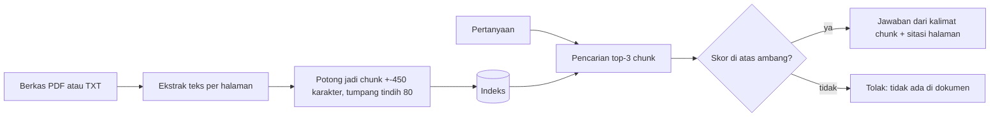

# DocuChat AI

Chatbot dukungan pelanggan yang hanya menjawab dari dokumen perusahaan (SOP, katalog, FAQ). Setiap jawaban menyebut halaman sumbernya. Jika dokumen tidak memuat jawabannya, bot menolak menjawab, bukan menebak.

**Demo langsung:** https://arilsaputra854.github.io/docuchat-ai/

## Yang bisa dicoba di demo

- Muat contoh SOP toko, atau unggah berkas TXT atau PDF milik Anda.
- Ajukan pertanyaan. Jawaban muncul bertahap, dengan penanda sitasi `[1]`, `[2]` yang mengarah ke kutipan di panel kanan.
- Ajukan pertanyaan di luar dokumen (misalnya "siapa presiden amerika?") untuk melihat bot menolak menjawab.
- Salin kode embed untuk memasang widget di website lain.
- Lihat riwayat pertanyaan pelanggan beserta statusnya (terjawab atau tidak ada di dokumen).

## Cara kerja



Setiap chunk membawa nomor halamannya, sehingga sitasi tidak perlu ditebak model.

## Demo vs produksi

| Bagian | Demo ini | Versi produksi yang saya bangun untuk klien |
|---|---|---|
| Pencarian | BM25 di browser | Embedding Gemini, disimpan di Supabase pgvector |
| Jawaban | Kalimat terpilih dari chunk (ekstraktif) | Gemini, dibatasi hanya pada chunk hasil pencarian |
| Streaming | Disimulasikan per kata | Server-Sent Events dari API route |
| Penyimpanan | Memori browser | PostgreSQL, satu tenant per perusahaan |

Demo tidak memakai model bahasa. Logika yang benar-benar berjalan: pemotongan teks, pengindeksan, peringkat BM25, ambang penolakan, dan sitasi halaman.

Skema produksi yang dituju:

```sql
create extension vector;
create table chunks (
  id bigserial primary key,
  tenant_id uuid not null,
  doc text not null,
  page int not null,
  content text not null,
  embedding vector(768)
);
create index on chunks using hnsw (embedding vector_cosine_ops);
-- select content, page from chunks
--   where tenant_id = $1 order by embedding <=> $2 limit 4;
```

## Menjalankan lokal

```bash
git clone https://github.com/Arilsaputra854/docuchat-ai.git
cd docuchat-ai
npx serve .          # buka http://localhost:3000
npm test             # 4 test untuk chunking, pencarian, sitasi, penolakan
```

Tanpa langkah build. Berkas statis dengan ES modules.

## Struktur

```
index.html, style.css, app.js   antarmuka demo
src/core.js                     chunking, BM25, jawaban beralasan
widget.js                       widget embed (iframe mengambang)
test/core.test.mjs              test
DESIGN.md                       arah desain dan alasannya
```

## Batasan

- BM25 mencocokkan kata, bukan makna. Pertanyaan dengan sinonim bisa meleset, itulah alasan produksi memakai embedding.
- PDF hasil pindai (gambar) tidak berisi teks, dan demo akan menampilkan pesan galat. OCR bukan bagian proyek ini.
- Widget embed mengarah ke demo publik, bukan ke tenant sungguhan.

## Lisensi

MIT. Lihat [LICENSE](LICENSE).
